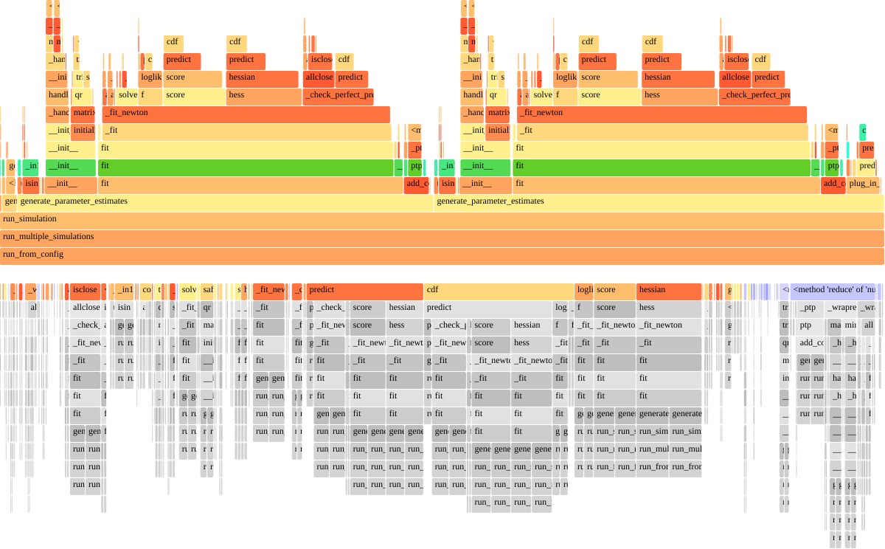

The entire runtime of the simulation was a little less than 37 seconds. THe profiler showed that the vast majority of time is spent on estimating the coefficients and not generating the data. 
Particularly long amounts of time are spent with the logistic regression fit method. This can be seen in performance_results/profiles/base/simulation_profile.txt or the associated flamegraph showbn here:

The computationaly complexity is O(n(m+1)). Generating the individuals is O(n), generating an experiment with the n individuals is O(n), and thus generating all the experiments is O(nm). Doing logitisc regression on the results of an experiement is O(n) empiraccly, but also theoretically, and thus the time complexity of doing all parameter rstiamtions is O(nm). There were no numerical warnings or convergence issues discovered.

