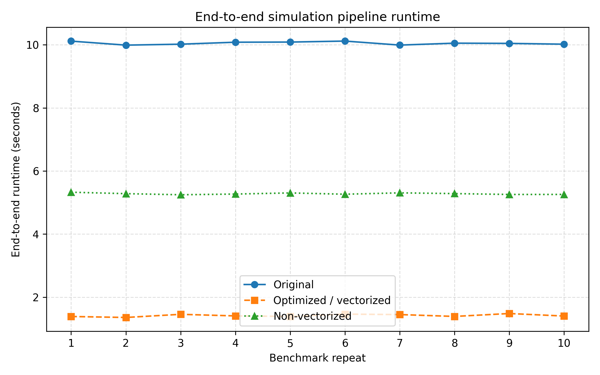
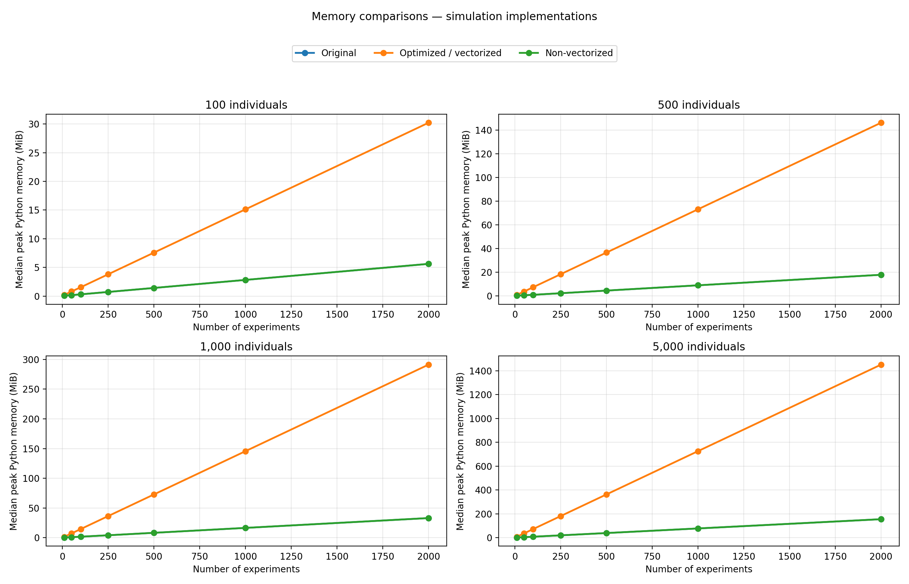

# Optimization 1


The majority of the time is spent fitting logistic regression

I applied an algorithmic improvement which reduces redundant computations (I only fit once rather than twice).

## Before

```python
estimator_results = {}

for estimator in self.param_estimators:
    estimator_name = type(estimator).__name__

    estimates, auxiliary = (
        estimator.generate_parameter_estimates(
            experiment_results
        )
    )

    estimator_results[estimator_name] = {
        "estimates": estimates,
        "auxiliary": auxiliary,
    }
```

## After

```python
plug_in_estimates, beta_mat = (
    self.param_estimator.generate_parameter_estimates(
        experiment_results
    )
)

logit_estimates = beta_mat[:, 1].copy()

# Preserve the original result names and structure.
estimator_results = {
    "LogitModelPlugIn": {
        "estimates": plug_in_estimates,
        "auxiliary": beta_mat,
    },
    "LogitModelEstimator": {
        "estimates": logit_estimates,
        "auxiliary": beta_mat,
    },
}
```

This improved runtime by about 1.9x for the entire simulation. No impact on memory usage or stability gains

The main trade off is in code readability and extensibility. Before, my simulation method took in a list of methods, but now I instead just always use this one method, and do not take them in as separate methods.

This improvement can be seen os original vs non-vectorized. You can see how it improves for a given simulation setup.


Alternatively, here you can see the overall run time comparisons.



# Optimization 2

My other improvement was to vectorize the logistic regression fits over experiments. This was to solve the same problem as before. Rather than fitting a new logit model for each experiement, I did it all at once using vectorization.

## Before

```python
for exp_result in experiment_results:
    ...
    fitted_result = sm.Logit(outcomes, X).fit(disp=False)
    plug_in_estimate = self.plug_in_differential_log_odds(
        fitted_result,
        covariates,
    )

    beta_mat.append(fitted_result.params)
    plug_in_estimates.append(plug_in_estimate)
```

## After

```python
for experiment_index, experiment_result in enumerate(experiment_results):
    ...
    assignment_matrix[experiment_index] = assignments
    outcome_matrix[experiment_index] = outcomes

...

for _ in range(self.max_iter):
    ...
    newton_steps = np.linalg.solve(
        hessian_matrices,
        score_vectors[..., None],
    )[..., 0]
    ...
```

As you can see from the charts it runs faster, however it takes up a lot more memory. This can be seen by the associated charts.




However, the speedup depends drastically on what computer you are using. The charts you see above were all from my mac, while my older pc actually had much less speedup, including no improvement when simulating 5000 individuals.

One other thing to note is that this code, when run on my mac (but not my windows), often produces the following: "Warnings: RuntimeWarning: divide by zero encountered in matmul | RuntimeWarning: invalid value encountered in matmul | RuntimeWarning: overflow encountered in matmul". According to the internet, this is a known mac bug, and need not be evidence of convergence issues, especially as my regression tests pass.


# LESSONS LEARNED
Removing duplicated code was the best return on investment since it gave a sizeable performance boost for minimal results. I was minimally surprised about where time was spent. I rogiinally planned to vectorize the experiment creations, but since the profiling showed that very little time was spent there I decided against it. In general, I think any optimziatinos regarding the DGP would not be worth it here.

One other thing I learned is that an optimization may have different levels of effect on different hardware. While obviously possible, I did not expect such thigns to happen here. 
